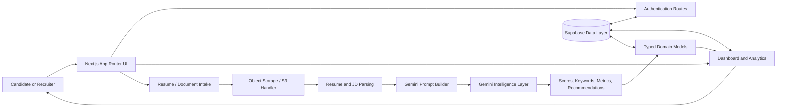

# ATSync AI

> **The intelligence layer between a resume and the right opportunity.**

ATSync AI is an AI-powered Applicant Tracking & Resume Intelligence Platform built to make hiring more signal-driven, more transparent, and dramatically less dependent on keyword guesswork. It brings resume parsing, job-description alignment, missing-keyword discovery, ATS scoring, recruiter analytics, and Gemini-driven optimization insights into one focused experience.

Instead of treating a resume as a static document, ATSync AI treats it as **structured career data**: a living profile of skills, experience, achievements, terminology, and potential. By comparing candidate information against the language and intent of a job description, the platform turns an opaque application process into an actionable optimization loop.

> **Parse smarter. Match deeper. Optimize with confidence.**

[](https://www.typescriptlang.org/)
[](https://nextjs.org/)
[](https://react.dev/)
[](https://tailwindcss.com/)
[](LICENSE)

---

## Table of Contents

- [Why ATSync AI?](#why-atsync-ai)
- [Platform Highlights](#platform-highlights)
- [Capability Matrix](#capability-matrix)
- [Architecture & Data Flow](#architecture--data-flow)
- [Application Architecture](#application-architecture)
- [The Intelligence Pipeline](#the-intelligence-pipeline)
- [Repository Structure](#repository-structure)
- [Tech Stack](#tech-stack)
- [Getting Started](#getting-started)
- [Available Commands](#available-commands)
- [Product Principles](#product-principles)
- [Roadmap](#roadmap)
- [Contributing](#contributing)
- [License](#license)

---

## Why ATSync AI?

Modern hiring is full of friction:

- Candidates often do not know why a strong application is being filtered out.
- Recruiters have to manually translate resumes into comparable signals.
- Job descriptions contain important terminology that is easy to overlook.
- Traditional ATS workflows can over-index on exact keywords without explaining context.
- Hiring teams need a fast way to move from **document** to **decision support**.

ATSync AI is designed to close that gap. It gives candidates a clearer optimization path and gives recruiters a more structured view of applicant-job alignment.

### One platform, two perspectives

| Audience | What ATSync AI helps with |
| --- | --- |
| **Candidates** | Understand alignment, discover missing keywords, strengthen positioning, and receive actionable optimization guidance. |
| **Recruiters** | Review structured candidate signals, compare fit indicators, identify skill gaps, and work from a clearer screening baseline. |
| **Hiring teams** | Create a more consistent, explainable, and data-informed workflow from intake to shortlist. |
| **Career platforms** | Build resume intelligence and job-matching experiences on top of a modern TypeScript foundation. |

---

## Platform Highlights

### 🧠 Resume intelligence
Transform unstructured resume content into meaningful candidate signals, including experience, skills, keywords, and optimization opportunities.

### 🎯 Job-description alignment
Compare candidate profiles with job requirements to surface the language and capabilities that matter most for a target role.

### 🔎 Missing-keyword discovery
Identify relevant terms that appear in the job description but are absent, underrepresented, or insufficiently emphasized in the resume.

### 📊 ATS scoring and structural metrics
Present match indicators and resume-quality metrics in a format that is easy to scan, understand, and act on.

### ✨ Gemini-driven recommendations
Use AI-generated recommendations to move beyond a raw score and toward practical improvements: what to clarify, what to emphasize, and where the story can become stronger.

### 📈 Recruiter analytics
Provide dashboard-oriented visibility into candidates, scores, trends, and structural signals so hiring teams can focus their attention where it creates the most value.

### 🌑 Enterprise-ready visual language
A dark, focused interface system designed for high-density information, rapid review, and serious workflow tooling.

---

## Capability Matrix

| Capability | Candidate value | Recruiter value | Output |
| --- | --- | --- | --- |
| Resume parsing | Converts a resume into understandable signals | Reduces manual first-pass review | Structured candidate metadata |
| JD comparison | Shows how closely a resume maps to a role | Creates a repeatable screening baseline | Match score and comparison metrics |
| Keyword analysis | Reveals terms worth adding or strengthening | Highlights skill and terminology gaps | Missing-keyword list |
| AI recommendations | Provides a prioritized improvement path | Adds context to quantitative signals | Optimization recommendations |
| Dashboard analytics | Makes progress visible | Supports faster candidate triage | Metric cards, filters, and analytics views |
| Typed domain models | Encourages consistent data handling | Makes future integrations safer | TypeScript interfaces and contracts |

---

## Architecture & Data Flow

ATSync AI follows a modular, user-facing application architecture where the interface, domain logic, integrations, and typed data contracts remain clearly separated. The goal is simple: every resume insight should have a traceable path from **input** to **interpretation** to **action**.

### High-level architecture



### End-to-end data flow

| Stage | Flow | What happens |
| --- | --- | --- |
| **1. Intake** | Resume + job description → application | A candidate document and target role enter the product workflow. |
| **2. Storage** | Document → object storage | Upload handling is isolated so files can be managed independently from UI concerns. |
| **3. Parsing** | Raw text → extracted fields | Resume and job-description content is interpreted into structured information. |
| **4. Normalization** | Extracted fields → typed domain data | Candidate metadata, match scoring, missing keywords, and recommendations follow explicit TypeScript contracts. |
| **5. Intelligence** | Candidate profile + JD → AI analysis | Gemini-oriented prompt construction supports contextual extraction and optimization guidance. |
| **6. Evaluation** | AI output → metrics | The system converts analysis into readable scores, keyword insights, and structural indicators. |
| **7. Presentation** | Metrics → dashboards | Recruiters and candidates see actionable information through focused dashboard components. |
| **8. Optimization loop** | Recommendations → improved resume | Insights become the next editing step, creating a continuous resume-improvement cycle. |

### The optimization loop

```text
Resume
  │
  ▼
Parse and structure
  │
  ▼
Compare against target job description
  │
  ▼
Detect missing or weak signals
  │
  ▼
Generate AI-backed recommendations
  │
  ▼
Improve resume positioning
  │
  └──────────────► Re-evaluate
```

### Design intent

The architecture is deliberately shaped around four principles:

1. **Separation of concerns** — UI components should not need to understand every storage or AI integration detail.
2. **Typed intelligence** — analysis results should be represented as predictable domain objects, not scattered unstructured values.
3. **Actionable output** — a score without an explanation is just a number; ATSync AI emphasizes the next useful action.
4. **Composable growth** — parsing, storage, AI analysis, dashboards, and analytics should be able to evolve without forcing a complete rewrite of the application.

---

## Application Architecture

| Layer | Location | Responsibility |
| --- | --- | --- |
| Presentation | `src/app` | Routes, layouts, landing experience, authentication screens, dashboard pages, and analytics views. |
| Design system | `src/components/ui` | Reusable interface primitives for a consistent enterprise visual language. |
| Product components | `src/components/dashboard` | ATS score meters, candidate list views, filters, analytics cards, and structural metric displays. |
| Integration and domain utilities | `src/lib` | S3 upload-handler configuration, Supabase bindings, and Gemini extraction prompt construction. |
| Data contracts | `src/types` | Candidate metadata, match scoring, missing keywords, and optimization recommendation interfaces. |
| Styling | Tailwind CSS / PostCSS | Responsive layout, visual hierarchy, theme styling, and component-level presentation. |

---

## The Intelligence Pipeline

ATSync AI is designed around an intelligence pipeline rather than a single black-box score.

### 1. Context collection
The platform gathers the two pieces of context that matter most: **who the candidate is** and **what the role requires**.

### 2. Semantic extraction
Resume and job-description content is transformed into structured signals so that the system can reason over skills, experience, terminology, and role expectations.

### 3. Alignment analysis
Candidate signals are compared with the target role to identify areas of strength, partial alignment, and opportunity.

### 4. Gap detection
Missing or weakly represented keywords are surfaced so the user can distinguish between an absent skill, an unclear phrase, and an opportunity to make existing experience more discoverable.

### 5. Explainable recommendations
Recommendations are intended to answer the question that matters most after every score:

> **“What should I improve next?”**

### 6. Dashboard delivery
The output is delivered through high-signal UI components that support rapid scanning without hiding the underlying story.

---

## Repository Structure

```text
atsync-ai/
├── public/                    # Static assets
├── src/
│   ├── app/                   # Next.js App Router pages and routes
│   │   ├── login/             # Authentication entry point
│   │   ├── signup/            # Account creation entry point
│   │   └── dashboard/         # Recruiter workspace and analytics
│   ├── components/
│   │   ├── ui/                # Reusable UI primitives
│   │   └── dashboard/         # ATS and analytics product components
│   ├── lib/                   # Storage, Supabase, and Gemini utilities
│   └── types/                 # Shared TypeScript domain contracts
├── next.config.ts             # Next.js configuration
├── postcss.config.mjs         # PostCSS / Tailwind integration
├── tsconfig.json              # TypeScript configuration
├── package.json               # Scripts and dependencies
└── README.md                  # Product and engineering documentation
```

---

## Tech Stack

| Technology | Role in ATSync AI |
| --- | --- |
| **Next.js 15** | Full-stack React framework and App Router foundation. |
| **React 19** | Component-driven product interface. |
| **TypeScript** | Typed application logic and domain contracts. |
| **Tailwind CSS 4** | Utility-first styling and responsive UI composition. |
| **Supabase** | Application data and authentication integration point. |
| **AWS S3** | Resume and document storage integration point. |
| **Gemini** | AI-powered extraction and optimization prompt workflow. |
| **ESLint** | Code-quality and consistency checks. |

### Language composition

| Language | Approximate composition |
| --- | ---: |
| TypeScript | 97% |
| CSS | 2.5% |
| JavaScript | 0.5% |

---

## Getting Started

### Prerequisites

- Node.js 20 or newer recommended
- npm
- Access to the required Supabase, storage, and Gemini configuration when enabling connected workflows

### Installation

```bash
git clone https://github.com/lakshyakurup/atsync-ai.git
cd atsync-ai
npm install
```

### Environment configuration

Create a local environment file for the integrations you enable in your environment. Keep secrets out of source control.

```bash
# .env.local
# Add the Supabase, object-storage, and Gemini values required by your deployment.
```

### Run locally

```bash
npm run dev
```

Then open [http://localhost:3000](http://localhost:3000) in your browser.

---

## Available Commands

| Command | Purpose |
| --- | --- |
| `npm run dev` | Start the local Next.js development server. |
| `npm run build` | Create a production build. |
| `npm run start` | Start the production server after building. |
| `npm run lint` | Run the configured lint checks. |

### Validate before submitting changes

```bash
npm run lint
npm run build
```

---

## Product Principles

### Signal over noise
The goal is not to produce more data. The goal is to surface the data that changes the next decision.

### Explainability over mystery
Scores should lead to understanding. Understanding should lead to action.

### Structure without losing nuance
A resume is more than a bag of keywords. Structured analysis should make nuance easier to see, not erase it.

### Speed with substance
Recruiters need fast scanning. Candidates need meaningful guidance. The interface is designed to support both without turning the product into a spreadsheet maze.

### Human judgment, amplified
ATSync AI is designed to support better decisions, not replace thoughtful hiring judgment. The strongest workflow combines machine-assisted pattern recognition with human context and accountability.

---

## Roadmap

The platform is positioned to grow toward a broader resume intelligence ecosystem. Potential areas include:

- Richer resume parsing and document-format support
- Role-specific scoring models and configurable evaluation criteria
- Candidate comparison and shortlist workflows
- Resume version history and optimization experiments
- Deeper recruiter analytics and funnel reporting
- Explainable score breakdowns and evidence-linked recommendations
- Collaboration workflows for hiring teams
- Integrations with job boards, HR systems, and career platforms
- Evaluation datasets for improving extraction quality and consistency

> The long-term vision: make every application more understandable, every recommendation more actionable, and every hiring workflow more intentional.

---

## Contributing

Contributions, ideas, and thoughtful product feedback are welcome.

1. Fork the repository.
2. Create a focused branch for your change.
3. Make the smallest coherent improvement.
4. Run `npm run lint` and `npm run build`.
5. Open a pull request with context, screenshots where relevant, and validation notes.

For larger changes, start a discussion first so the implementation aligns with the product direction.

---

## License

ATSync AI is available under the [MIT License](LICENSE).

---

## Built for the moment a resume becomes a possibility

Hiring should not be a guessing game. Candidates deserve to understand how they are being evaluated. Recruiters deserve signal they can trust. ATSync AI brings those needs together through structured data, thoughtful interfaces, and AI-assisted insight.

**From resume upload to meaningful opportunity — ATSync AI keeps the signal in sync.**
